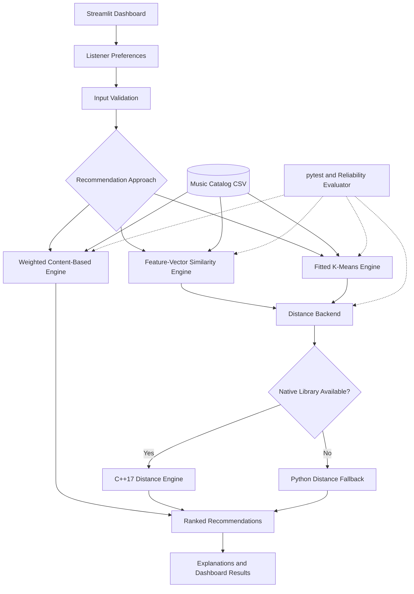

# VibeMatch Fusion
### Applied AI Music Recommender | Python, Machine Learning & C++17

**CodePath AI110 — Final Project**

**Developer:** Joanne Jongeling  
**Primary Language:** Python 3.13  
**Technologies:** Python, Streamlit, C++17, CMake, ctypes, pytest, CSV, GitHub Actions  
**Repository:** [VibeMatch Fusion — GitHub](https://github.com/JoanneStars/ai110-applied-ai-music-recommender)

---

## Project Overview

VibeMatch Fusion is an interactive music recommendation application that combines explainable content-based filtering, feature-vector similarity, unsupervised machine learning, and optional native C++ acceleration.

The application generates personalized song recommendations based on listener preferences, including genre, mood, energy, and acoustic characteristics.

Its Streamlit dashboard presents recommendations through a futuristic, orbital-inspired interface with interactive preference controls, song rankings, visualizations, and model information.

The project's central objective is to demonstrate how a relatively small recommendation system can evolve into a modular, testable application that integrates multiple recommendation approaches while preserving transparency and reliability.

VibeMatch Fusion extends my original CodePath AI110 Module 3 Music Recommender Simulation into a more comprehensive final project.

### Key Capabilities

- Interactive Streamlit recommendation dashboard
- Explainable, weighted content-based recommendations
- Feature-vector similarity recommendations
- Fitted k-means clustering model
- Native C++17 distance calculations through Python interoperability
- Automatic Python fallback when the native library is unavailable
- Input validation and error handling
- Deterministic and reproducibility testing
- Automated reliability evaluation
- Cross-platform build and test workflow
- Modular architecture with separated application, model, and testing components

The application does not depend on a paid music API or external generative AI service to produce recommendations.

---

## 1. Project Background

### Original Implementation

The original project was developed for CodePath AI110 Module 3.

It introduced a content-based recommendation system that ranked songs using listener preferences and predefined feature weights.

**Original repository:** [AI110 Module 3 Music Recommender Simulation](https://github.com/JoanneStars/ai110-module3show-musicrecommendersimulation-starter)

The original implementation demonstrated foundational recommendation concepts, including:

- Song and user-profile representations
- Feature-based preference matching
- Numerical recommendation scoring
- Sorting and ranking
- Explanation generation

### Final Project Evolution

For my final project, I expanded the original implementation through several development stages.

**Phase 1 — Reliability Engineering**

I improved input validation, error handling, automated testing, evaluation consistency, and project organization.

**Phase 2 — Interactive Dashboard**

I introduced a Streamlit web interface that allows users to configure music preferences and explore recommendations visually.

**Phase 3 — Additional Recommendation Engines**

I implemented feature-vector similarity and a fitted clustering model to explore recommendation methods beyond manually weighted scoring.

**Phase 4 — Native C++ Integration**

I added a C++17 distance-computation backend using CMake and Python's `ctypes` interface, retaining a pure-Python fallback.

**Phase 5 — Integration Testing**

I expanded the automated tests to validate trained-model behavior, deterministic results, distance calculations, invalid inputs, and backend consistency.

This development process transformed an introductory recommendation exercise into a more structured software engineering and applied AI project.

---

## 2. Application Interface

VibeMatch Fusion includes a custom Streamlit dashboard with a dark, space-inspired visual design.

The interface uses deep navy backgrounds, violet accents, cyan highlights, and an orbital visualization to create a cohesive application identity.

### Dashboard Features

**Listener Preferences**

Users can configure:

- Favorite genre
- Preferred mood
- Desired music energy
- Acoustic preference
- Number of recommendations

**Recommendation Display**

The application presents ranked song recommendations based on the selected approach and preferences.

**Catalog Information**

The dashboard displays catalog statistics, including:

- Available tracks
- Genre channels
- Mood profiles

**Model Transparency**

The interface can display recommendation explanations, feature information, active recommendation logic, and computation backend information.

The dashboard distinguishes recommendation scoring from machine-learning techniques rather than representing every numerical score as an AI-generated prediction.

### Starting the Application

From the repository root:

```powershell
python -m streamlit run src/main.py
```

Streamlit typically makes the application available at:

`http://localhost:8501`

The app runs locally in a browser.

---

## 3. Dataset Development

The original dataset contained 10 songs. I expanded the catalog to 15 synthetic tracks to introduce additional combinations of genres, moods, and audio characteristics.

The additional songs were:

1. Velvet Nights
2. Wildfire Heart
3. Golden Fields
4. Neon Bounce
5. Ocean Dreams

### Song Attributes

| Attribute | Description |
|---|---|
| ID | Unique song identifier |
| Title | Song title |
| Artist | Performing artist |
| Genre | Musical classification |
| Mood | Descriptive listening mood |
| Energy | Numerical intensity value |
| Tempo | Beats per minute |
| Valence | Numerical representation of musical positivity |
| Danceability | Dance-oriented musical characteristic |
| Acousticness | Numerical acoustic characteristic |

The dataset is stored in:

`data/songs.csv`

### Dataset Limitations

The current catalog is intended for controlled experimentation.

A 15-song synthetic dataset is sufficient to test the system architecture, ranking behavior, and model integration, but it is not representative of a commercial music streaming catalog.

The project does not claim production-level recommendation accuracy.

---

## 4. Recommendation Architecture

VibeMatch Fusion separates recommendation methods into modular components.

The system includes three principal recommendation approaches.

### 4.1 Weighted Content-Based Filtering

**Primary module:** `src/recommender.py`

The original recommendation engine calculates relevance based on weighted matches between listener preferences and song features.

The scoring configuration is:

| Factor | Maximum contribution |
|---|---:|
| Genre match | 2.0 |
| Mood match | 1.0 |
| Energy similarity | 1.0 |
| Acoustic preference | 0.5 |
| **Total** | **4.5** |

Energy similarity is calculated using:

```python
1 - abs(song_energy - target_energy)
```

The acoustic component rewards songs based on whether their acoustic characteristics align with the listener's stated preference.

Songs are sorted by relevance and returned according to the requested recommendation limit.

**Important:** These scores represent weighted relevance, not calibrated probabilities.

#### Explainable Ranking

The baseline engine can explain recommendation decisions in terms of feature contributions.

For example, an explanation can identify:

- Genre alignment
- Mood alignment
- Energy similarity
- Acoustic preference compatibility

This makes the ranking system inspectable and easier to troubleshoot.

### 4.2 Feature-Vector Similarity

**Primary module:** `src/ai_engine.py`

The feature-vector recommendation engine represents song characteristics numerically and compares them against listener preferences.

This approach uses vector-distance calculations to estimate similarity.

Unlike the manually weighted baseline, feature-vector similarity measures numerical relationships in a defined feature space.

The implementation is designed to work without requiring NumPy or scikit-learn for its core distance calculations.

This reduces dependency complexity and supports the project's portable Python architecture.

Feature-vector similarity is a mathematical recommendation technique; it does not, by itself, constitute a trained machine-learning model.

### 4.3 Fitted K-Means Clustering

**Primary module:** `src/trained_engine.py`

VibeMatch Fusion also includes a fitted clustering engine using an unsupervised k-means approach.

The model groups songs according to similarities in their numerical features.

During fitting, the algorithm learns cluster centroids and assigns songs to clusters based on feature-space distance.

The trained engine then uses cluster information and feature similarity to generate and explain recommendations.

#### Why K-Means?

K-means was selected because it provides an understandable introduction to model fitting and unsupervised learning.

It also allows the project to demonstrate:

- Feature representation
- Cluster assignment
- Learned centroids
- Distance-based comparisons
- Reproducible model fitting
- Explainable model outputs

#### Important Distinction

The clustering engine is trained on the available song-feature dataset.

It is **not trained on real listening histories, user interactions, or human-labeled recommendation preferences**.

Therefore, the learned clusters describe patterns within the experimental catalog rather than proven listener taste categories.

---

## 5. Native C++17 Integration

**Native source:** `cpp/distance.cpp`  
**Build configuration:** `cpp/CMakeLists.txt`  
**Python interface:** `src/native_distance.py`

To extend the architecture beyond Python, I incorporated a native C++17 computation backend.

The native component performs Euclidean distance calculations.

Python communicates with the compiled library through the `ctypes` foreign-function interface.

### Computation Flow

1. Python constructs feature vectors.
2. The distance backend determines whether the native library is available.
3. When available, Python invokes the compiled C++ function.
4. The native implementation calculates the distance.
5. The result is returned to the Python recommendation engine.
6. If the native library cannot be loaded, Python uses the fallback implementation.

### Euclidean Distance

For vectors of equal dimension, the distance is:

**d(a, b) = √Σ(aᵢ − bᵢ)²**

For example:

```text
Vector A: [0, 0]
Vector B: [3, 4]

Euclidean distance: 5.0
```

### Native Backend Verification

The native C++ engine was successfully compiled on Windows using Microsoft's C++ Build Tools and CMake.

Local verification returned:

```text
Backend: C++17 native
Distance: 5.0
```

This confirms that Python successfully loaded the compiled C++ library and executed its distance function.

### Python Fallback

The application also supports a pure-Python implementation.

If the compiled C++ library is unavailable, the backend can report:

```text
Backend: Python fallback
```

The fallback provides the same distance-computation functionality without requiring users to compile native code.

### Performance Considerations

The native C++ component demonstrates cross-language interoperability and allows experimentation with native computation.

However, no formal performance benchmark has established that the native implementation is faster than the Python implementation for this small dataset.

For short vectors, the overhead of invoking native code can reduce or eliminate potential performance benefits.

The integration is therefore presented primarily as an architecture and interoperability improvement, not as a proven speed optimization.

---

## 6. System Architecture

The application separates the interface, recommendation engines, native computation, evaluation, and automated testing.

### Primary Components

| Component | Responsibility |
|---|---|
| `src/main.py` | Streamlit dashboard |
| `src/recommender.py` | Weighted recommendation logic and data models |
| `src/ai_engine.py` | Feature-vector similarity recommendation engine |
| `src/trained_engine.py` | Fitted clustering model |
| `src/native_distance.py` | Native-library loading and Python fallback |
| `src/evaluator.py` | Deterministic reliability evaluation |
| `cpp/distance.cpp` | Native C++17 distance implementation |
| `cpp/CMakeLists.txt` | CMake build configuration |
| `data/songs.csv` | Experimental music catalog |
| `tests/` | Automated integration and behavioral tests |
| `.github/workflows/cross_platform.yml` | Cross-platform CI configuration |

### Architecture Diagram



The architecture emphasizes separation of concerns, allowing individual recommendation approaches to be tested without requiring the entire user interface to run.

---

## 7. Development Structure

The principal project files are organized as follows:

```text
ai110-applied-ai-music-recommender/
│
├── .github/
│   └── workflows/
│       └── cross_platform.yml
│
├── cpp/
│   ├── CMakeLists.txt
│   └── distance.cpp
│
├── data/
│   └── songs.csv
│
├── src/
│   ├── __init__.py
│   ├── main.py
│   ├── recommender.py
│   ├── ai_engine.py
│   ├── trained_engine.py
│   ├── native_distance.py
│   └── evaluator.py
│
├── tests/
│   ├── test_ai_engine.py
│   ├── test_fusion_phase2.py
│   ├── test_guardrails.py
│   └── test_recommender.py
│
├── requirements.txt
├── model_card.md
├── ai_interactions.md
├── README.md
└── .gitignore
```

Additional evaluation tests are maintained in `src/tests/`.

Generated Python caches and the local `cpp/build/` directory are not part of the intended tracked source structure.

---

## 8. Installation and Execution

### Requirements

**Core application:**

- Python 3.13
- pip
- Dependencies from `requirements.txt`
- A supported operating system

**Optional native C++ build:**

- CMake
- A C++17-compatible compiler
- Platform-specific native build tools

The Python fallback allows the recommendation application to operate without compiling the C++ component.

### Clone the Repository

```powershell
git clone https://github.com/JoanneStars/ai110-applied-ai-music-recommender.git

cd ai110-applied-ai-music-recommender
```

### Install Python Dependencies

```powershell
python -m pip install -r requirements.txt
```

### Launch the Streamlit Dashboard

```powershell
python -m streamlit run src/main.py
```

Open the local Streamlit URL displayed in the terminal, typically:

`http://localhost:8501`

### Stop the Application

Press `Ctrl + C` in the terminal running Streamlit.

---

## 9. Building the Native C++ Engine

Native compilation is optional for running the application but required to activate the C++ backend.

### Windows

Install:

- CMake
- Microsoft Visual Studio Build Tools with **Desktop development with C++**

Open the **x64 Native Tools Command Prompt** for your installed Visual Studio version.

From the repository root, configure the build:

```bat
cmake -S cpp -B cpp/build -G "NMake Makefiles" -DCMAKE_BUILD_TYPE=Release
```

Compile the library:

```bat
cmake --build cpp/build
```

A successful build should produce:

```text
cpp/build/vibematch_distance.dll
```

If the build directory contains an incompatible previous CMake configuration, remove the generated `cpp/build/` directory and configure again.

### Verify Native Integration

Run:

```powershell
python -c "from src.native_distance import DistanceBackend; b=DistanceBackend(); print('Backend:', b.backend); print('Distance:', b.distance([0,0],[3,4]))"
```

Example verified Windows output:

```text
Backend: C++17 native
Distance: 5.0
```

### Linux and macOS

The project includes a CMake-based native implementation and platform-specific library loading support.

Native builds on Linux and macOS require an appropriate compiler and build environment.

Cross-platform compatibility should be evaluated using the GitHub Actions workflow rather than inferred from the successful Windows build alone.

---

## 10. Automated Testing

VibeMatch Fusion includes unit and integration tests covering recommendation behavior, input validation, trained-model consistency, and distance-backend functionality.

### Run the Complete Test Suite

From the repository root:

```powershell
python -m pytest -v
```

The latest verified local test result was:

```text
36 passed in 0.89s
```

### Test Coverage Areas

The automated test suite includes checks for:

**Content-Based Recommendations**
- Ranking order
- Recommendation limits
- Explanation generation
- Zero-result handling

**Feature-Vector Similarity**
- Preference-based ranking
- Similarity recommendation behavior
- Explanation generation
- Invalid energy values
- Empty catalog handling

**Fitted Clustering Model**
- Learned centroids and assignments
- Reproducible fitting
- Recommendation explanations
- Invalid cluster counts
- Zero recommendation limits

**Native Computation**
- Python and native distance parity
- Correct Euclidean distance results
- Invalid vector dimensions
- Non-finite input rejection

**Input Guardrails**
- Missing preferences
- Invalid song data
- Out-of-range numerical values
- Invalid acoustic preferences
- Negative recommendation limits

### Reliability Evaluation

The project also includes a dedicated deterministic evaluator:

```powershell
python -m src.evaluator
```

The most recently verified report contained:

```text
Checks passed: 10/10
Pass rate: 100%
```

These checks evaluate predictable behavior across predefined cases.

**A 100% test pass rate means the defined tests passed. It does not mean recommendations have 100% accuracy or that real users will prefer the recommended songs.**

---

## 11. Cross-Platform Continuous Integration

The repository includes a GitHub Actions workflow:

`.github/workflows/cross_platform.yml`

The workflow is intended to support automated build and testing across:

- Windows
- Linux
- macOS

Cross-platform testing is important because the application combines Python with compiled native code.

Different operating systems use different native-library formats and toolchains.

| Platform | Native library format |
|---|---|
| Windows | `.dll` |
| Linux | `.so` |
| macOS | `.dylib` |

### Verification Status

**Windows local development:** Native compilation and Python-to-C++ loading successfully verified.

**Linux and macOS:** Platform support is implemented, but successful execution should be confirmed through the repository's GitHub Actions results.

The presence of a workflow configuration does not independently prove that every platform's build has passed.

---

## 12. Feature-Weight Experiments

During the original Module 3 development, I experimented with the balance between genre and energy.

| Feature | Original experiment | Modified experiment |
|---|---:|---:|
| Genre | 2.0 | 1.0 |
| Energy | 1.5 | 3.0 |

Increasing the energy contribution caused songs with similar energy values to rank more competitively, even when their genres differed from the requested genre.

For example, *Storm Runner*, a rock song, appeared in recommendations for a high-energy pop profile during the earlier experiments.

This demonstrated a fundamental recommendation trade-off: improving alignment with one preference can reduce the relative influence of other attributes.

The final weighted baseline uses a more balanced combination of genre, mood, energy, and acoustic characteristics.

These earlier experiments are development history, not a description of the current fitted clustering model.

---

## 13. Recommendation Profile Experiments

I used multiple listener profiles to examine how preference combinations influenced results.

| Listener profile | Top recommendation observed in Module 3 |
|---|---|
| High-Energy Pop | Sunrise City |
| Chill Lofi | Library Rain |
| Deep Intense Rock | Storm Runner |

These examples were obtained from the earlier Module 3 implementation.

They are retained to document the project's original experimentation rather than presented as fresh results from every current recommendation engine.

The experiments showed that recommendation rankings depend on combinations of attributes, not solely on genre.

The expanded Fusion architecture allows additional comparisons between manually weighted ranking, feature similarity, and cluster-informed recommendations.

---

## 14. Technical Challenges and Resolutions

Developing VibeMatch Fusion involved several technical challenges across programming, testing, environment configuration, and version control.

### Challenge 1 — Python Syntax and Project Structure

Early development included malformed type annotations, incorrect indentation, and import errors.

I corrected these issues, separated application logic into modules, and used module-based Python commands from the repository root.

This improved consistency when running the application and tests.

### Challenge 2 — Dependency Compatibility

During development, a Windows security restriction prevented a compiled scikit-learn dependency from loading.

Rather than weakening operating-system security protections, I continued with a portable pure-Python implementation of the required clustering and similarity functionality.

This kept the project operational and reduced reliance on external compiled Python packages.

### Challenge 3 — Native C++ Compilation

Although CMake was installed, initial build attempts failed because the standard VS Code PowerShell terminal did not have access to Microsoft's compiler tools.

The errors included:

```text
CMAKE_CXX_COMPILER not set

nmake: no such file or directory
```

I installed and configured Microsoft Visual Studio C++ Build Tools and used the x64 Native Tools Command Prompt.

The native library subsequently compiled successfully:

```text
[100%] Built target vibematch_distance
```

### Challenge 4 — Python-to-C++ Interoperability

After compiling the library, I verified that Python could locate and load the native DLL through `ctypes`.

The runtime confirmed:

```text
Backend: C++17 native
Distance: 5.0
```

This demonstrated successful execution across the Python and C++ boundary.

### Challenge 5 — Cross-Platform File Organization

During integration, some files were initially placed in incorrect directories.

I corrected the locations of:

- C++ source files
- CMake configuration
- GitHub Actions workflow
- Integration tests

Generated native build artifacts were excluded from version control using `.gitignore`.

### Challenge 6 — Git and Repository Management

I used Git to track changes, commit development milestones, and synchronize the project with GitHub.

A final repository verification confirmed that the local working tree was clean and the local `main` branch was synchronized with `origin/main`.

These experiences reinforced the importance of understanding both application logic and the development environments required to build and distribute software.

---

## 15. Software Engineering Design Decisions

Several design principles guided the implementation.

### Modular Architecture

Recommendation logic is separated from the user interface and native computation backend.

This allows components to be tested and maintained independently.

### Explainability

The application provides explanations of recommendation behavior rather than presenting ranked outputs without context.

### Reproducibility

Deterministic evaluation and model-fitting tests help identify unexpected changes in behavior.

### Graceful Fallback

The native backend is optional. A working Python fallback prevents the application from depending entirely on a platform-specific binary.

### Input Validation

Invalid numerical inputs, malformed metadata, and unsupported preference values are checked before being used by the recommendation logic.

### Dependency Management

The implementation avoids unnecessary dependencies for core ranking and clustering functionality.

These decisions prioritize understandable behavior, testability, and maintainability.

---

## 16. Responsible AI and Limitations

VibeMatch Fusion is an educational applied AI project.

It is important to distinguish successful software execution from proven recommendation quality.

### Current Limitations

- The dataset contains only 15 synthetic songs.
- The clustering model learns from song features, not real listener behavior.
- Feature selection and normalization influence similarity results.
- Baseline scoring weights are manually configured.
- The catalog does not include live streaming-service data.
- The application does not learn continuously from user feedback.
- The recommendation system has not been evaluated through a large-scale user study.
- Native C++ acceleration has not been formally benchmarked against Python.
- Windows native integration has been locally verified; cross-platform status depends on CI results.

### Responsible Development Considerations

The recommendation system should not be described as understanding a listener's personal identity, emotions, or psychological condition.

Mood and genre are user-provided preferences and song metadata.

Cluster assignments represent mathematical groupings within the available feature space.

Recommendation relevance should be evaluated using realistic data and user feedback before making broader claims about personalization quality.

The project does not collect private listening histories or require user authentication.

Additional design considerations are documented in `model_card.md`.

---

## 17. Future Improvements

Potential future development includes:

1. **Larger datasets:** Expand beyond the 15-song experimental catalog.
2. **User feedback:** Incorporate explicit ratings or preference corrections.
3. **Model evaluation:** Compare ranking performance using relevant recommendation metrics.
4. **Feature engineering:** Experiment with valence, danceability, and tempo in additional ranking methods.
5. **Performance benchmarking:** Measure the costs and benefits of C++ distance calculations.
6. **Cross-platform verification:** Confirm successful native compilation and tests across supported operating systems.
7. **Model persistence:** Explore saving fitted model parameters rather than refitting when unnecessary.
8. **Expanded visualization:** Add interactive comparisons of recommendation approaches and cluster assignments.

These are possible extensions, not claims about features already implemented.

---

## 18. What I Learned

This project allowed me to apply concepts from software engineering, data structures, algorithms, and introductory machine learning.

Beginning with a relatively simple recommendation engine, I learned how to expand a project without abandoning its original functionality.

The development process strengthened my understanding of:

- Content-based recommendation systems
- Numerical feature representation
- Distance-based similarity
- Unsupervised learning
- K-means clustering
- Algorithmic explainability
- Python package organization
- Native C++ compilation
- Python interoperability through `ctypes`
- Build systems and compiler environments
- Automated unit and integration testing
- Continuous integration
- Git and GitHub version control

One of the most valuable lessons was that an application can produce mathematically correct results while still requiring careful evaluation of whether those results are useful.

Automated tests verify defined expectations. Meaningful recommendation quality requires broader evidence.

I also gained experience troubleshooting the differences between writing source code, compiling native dependencies, configuring development tools, and validating a complete application.

---

## 19. AI Collaboration and Development Transparency

AI assistance was used during portions of the development process for code review, troubleshooting, architectural planning, documentation, and testing support.

Suggested changes were incorporated into the local project, executed, and checked through automated tests and runtime verification.

Examples of AI-assisted development activities include:

- Reviewing Python functions and type annotations
- Debugging import and dependency issues
- Structuring recommendation engine components
- Developing test cases
- Troubleshooting CMake and compiler configuration
- Reviewing Python-to-C++ interoperability

The use of AI assistance does not replace the requirement to verify program behavior.

The final local implementation was evaluated through automated tests, the reliability evaluator, and native backend execution checks.

Development interactions and responsible-use considerations are documented separately in `ai_interactions.md` and `model_card.md`.

---

## 20. Portfolio Summary

VibeMatch Fusion demonstrates the development of a modular applied AI application using Python, unsupervised machine learning, interactive visualization, and native C++ interoperability.

The project brings together recommendation algorithms, feature engineering, model fitting, software testing, and build-system configuration within a single application.

Its verified local implementation includes:

- A working Streamlit dashboard
- Explainable weighted recommendations
- Feature-vector similarity
- Fitted k-means clustering
- A compiled and successfully loaded Windows C++17 distance backend
- A functional Python fallback
- 36 passing automated tests
- 10 passing reliability checks
- Version-controlled source code maintained on GitHub

The project reflects my interest in developing reliable, explainable, and technically structured software systems.

---

**Developer:** Joanne Jongeling  
**Course:** CodePath AI110  
**Project:** VibeMatch Fusion — Applied AI Music Recommender  
**Repository:** https://github.com/JoanneStars/ai110-applied-ai-music-recommender

*VibeMatch Fusion is an educational software engineering and applied AI project. All reported verification results refer to the tested local implementation unless otherwise specified.*